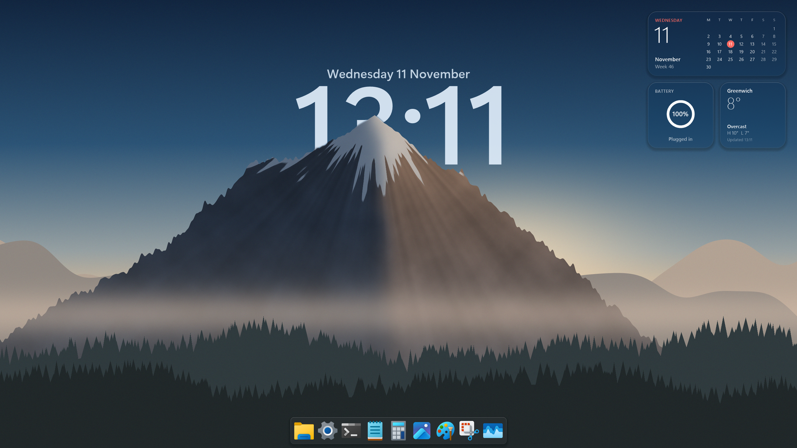
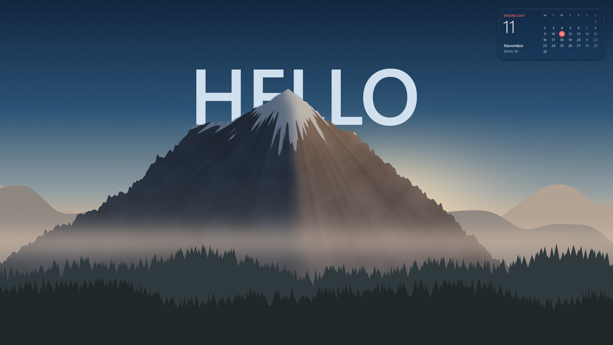
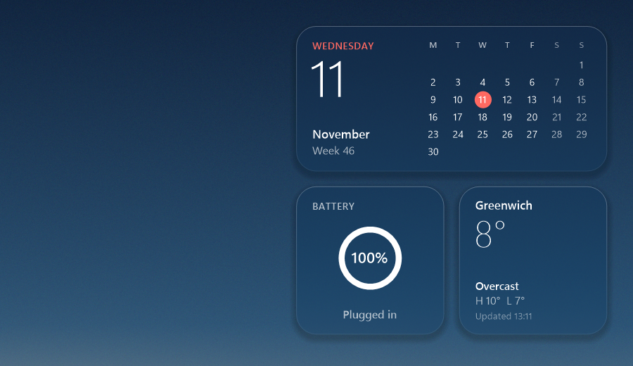
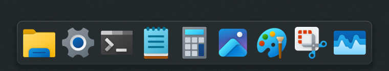
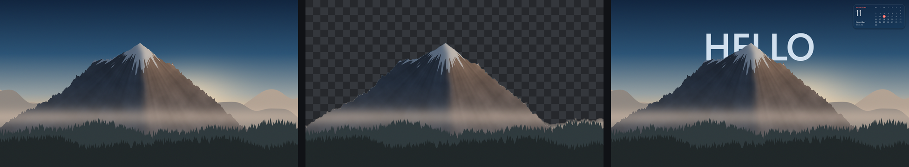

# designyourwindows

[](https://github.com/Sohwhat6420/designyourwindows/actions/workflows/build.yml)


A clock behind the subject of your own wallpaper, frosted-glass widgets and a macOS-style dock, for Windows 10 and 11.
One 62 KB native exe and one Python script. No browser, no web view, no live-wallpaper engine: the wallpaper is an
ordinary bitmap that Windows draws as it always does.



*Minute mode at 1920 × 1080. The time, date, battery and weather are real readings taken when the frame was drawn.
The dock in this image is the exe's own preview render of the dock window (see [Screenshots](#screenshots)).*



*Static mode: your own text, drawn once. Nothing is left running, so the frame shows only what cannot go stale
before midnight: the calendar.*

| Widgets | Dock |
| --- | --- |
|  |  |



*The image, the cut-out (subject plus the ground nearer than the sky) and the result: the text is drawn between them.*

## What it does

1. **Depth effect.** `make-layers.py` cuts your image into a plate and a foreground at your screen's size, using two
   small models on the CPU. The exe draws the clock (or your text) on the plate and the foreground over it, so the
   subject stands in front of the time.
2. **macOS aesthetic.** Frosted-glass panels cut from a pre-blurred copy of your own wallpaper, Segoe UI Variable
   (Windows' own typeface) on a real type scale, hairline edges and soft shadows; a borderless dock with rounded
   corners and DWM acrylic.
3. **Glass widgets.** The date, a month calendar (Monday first, today in red, ISO week number) and the battery.
   Weather is off by default; turn it on and it reads [Open-Meteo](https://open-meteo.com), which needs no key, for
   the latitude and longitude in `config.json`. Nothing personal is read or shown: no accounts, no events, no
   location lookup.

### Two modes, one switch

`"mode"` in `config.json`:

| Mode | What runs | What you see |
| --- | --- | --- |
| `"minute"` (default) | one small background process: it redraws the time strip once a minute and keeps the dock | the time and date behind the subject, calendar, battery, weather if on, the dock |
| `"static"` | nothing: the exe draws one frame, sets it as the wallpaper and exits | your text (or the date) behind the subject and the calendar; no dock |

In static mode, `--install` also re-renders at 00:00:30 every day so the date and calendar stay right. Battery and
weather are left out of the static frame on purpose: a frame drawn once would show a reading that is soon wrong.

## Install

You need Windows 10 or 11 (the .NET Framework 4.x compiler is part of Windows) and, for cutting your own image,
Python 3.

```powershell
git clone https://github.com/Sohwhat6420/designyourwindows
cd designyourwindows
powershell -ExecutionPolicy Bypass -File .\build.ps1      # writes bin\designyourwindows.exe; no SDK needed
```

### Get the two models (once)

Both run on the CPU through ONNX Runtime. Put them in `models/` (git-ignored) under these names:

| Save as | Model | Download | Licence |
| --- | --- | --- | --- |
| `models/birefnet-lite.onnx` | BiRefNet general lite, the subject mask (224 MB) | [rembg's release](https://github.com/danielgatis/rembg/releases/download/v0.0.0/BiRefNet-general-bb_swin_v1_tiny-epoch_232.onnx) | MIT |
| `models/depth-anything-v2-small.onnx` | Depth Anything V2 Small, what is nearer than the sky (99 MB) | [onnx-community on Hugging Face](https://huggingface.co/onnx-community/depth-anything-v2-small/resolve/main/onnx/model.onnx) | Apache 2.0 |

```powershell
python -m pip install numpy opencv-python onnxruntime pillow
```

### Cut your image

```powershell
python -I make-layers.py C:\path\to\your-image.jpg
```

It writes `layers/plate.png`, `layers/fg.png`, `layers/glass.png` and `layers/layout.json` at your primary screen's
size in physical pixels. Options: `--size 2560x1440` for another size,
`--anchor 0.3` to crop an image taller than the screen nearer its top (`0` top, `1` bottom), `--clock-width 0.30`
for a narrower clock box. A landscape image with a clear subject in the lower half and sky above works best; the
script places the clock box where the subject covers the lower part of the digits and leaves them readable.

No image to hand? `python -I make-layers.py --sample sample.png` draws the procedural mountain used in these
screenshots; run it through `make-layers.py` like any other image.

### Run

```powershell
.\bin\designyourwindows.exe                    # the mode config.json names
.\bin\designyourwindows.exe --static           # static mode, whatever the config says
.\bin\designyourwindows.exe --no-dock          # minute mode without the dock
.\bin\designyourwindows.exe --render try.png   # one frame to a file; the wallpaper is left alone
.\bin\designyourwindows.exe --stop             # stop a running copy
```

`--render` also takes `--time 2026-11-11T09:41`, `--static` and `--dock-preview`. Right-click the dock for *Edit
dock.json* and *Quit*.

### Start at sign-in

```powershell
.\bin\designyourwindows.exe --install              # minute mode, with the dock
.\bin\designyourwindows.exe --install --static     # static mode: at sign-in and at midnight
```

This creates one per-user scheduled task named `designyourwindows` (no administrator rights needed) and starts it.

### Uninstall

```powershell
.\bin\designyourwindows.exe --uninstall
```

It stops a running copy, deletes the scheduled task and puts back the wallpaper you had before (its path, fit and
tiling; if the original file has gone, the copy of what Windows was showing). Then delete the folder, and
`%LOCALAPPDATA%\designyourwindows` if you like (it holds the frame and a small log). Two honest limits: if you had a
slideshow or Windows Spotlight, you get the picture that was showing, so pick the slideshow again in Settings; and
Settings' *Recent images* keeps the frame as one entry, as it does for any wallpaper you set.

## Configuration

`config.json` sits next to `bin\` (or pass `--config PATH`). Every key is optional.

| Key | Default | What it does |
| --- | --- | --- |
| `mode` | `"minute"` | `"minute"` or `"static"` |
| `layers` | `"layers"` | the folder `make-layers.py` wrote |
| `clock.format` | `"HH:mm"` | .NET date format for the time; `"h:mm"` for a 12-hour clock |
| `clock.text` | `""` | your own text instead of the time (a name, a word); used in both modes |
| `clock.noClockFormat` | `"d MMMM"` | what static mode shows when `clock.text` is empty |
| `clock.font`, `clock.weight` | `"Segoe UI Variable Display"`, `"Semibold"` | any installed family; weights from Light to Bold |
| `clock.fontFile` | `""` | a `.ttf` or `.otf` of your own, used instead of `clock.font` |
| `clock.ink`, `clock.opacity` | from `layout.json`, `0.92` | the text colour (`"#rrggbb"`) and how solid it is |
| `date.show`, `date.format` | `true`, `"dddd d MMMM"` | the date line above the time (minute mode) |
| `widgets.side` | `"right"` | `"right"` or `"left"` |
| `widgets.calendar`, `widgets.battery` | `true` | battery only appears on a PC that has one |
| `widgets.weekStartsMonday` | `true` | the calendar's first column |
| `widgets.scale`, `dock.scale` | `1.0` | on top of the automatic scale (display scaling, or screen height for large screens at 100 %) |
| `weather.enabled` | `false` | Open-Meteo, keyless; `place` is only the label shown |
| `weather.latitude`, `weather.longitude`, `weather.units`, `weather.refreshMinutes` | Greenwich, `"celsius"`, `30` | the panel hides if the last reading is over three hours old |
| `dock.enabled`, `dock.file` | `true`, `"dock.json"` | minute mode only |
| `dock.backdrop` | `"acrylic"` | `"acrylic"` (tinted for light or dark mode), `"blur"`, or `"system"` (the Windows 11 transient backdrop) |
| `advanced.minuteFlags` | `0` | the `SystemParametersInfo` flags for the per-minute update; see below |

`dock.json` lists the apps, in order. Each has a `name` (the tooltip) and either an `appId` (a Store or system app,
as `Get-StartApps` prints it) or a `path` (an exe or any file; `%VARIABLES%` are expanded), plus optional `args`.
Icons are read from Windows at run time, so nothing is bundled.

```json
{ "apps": [
  { "name": "File Explorer", "path": "%WINDIR%\\explorer.exe" },
  { "name": "Terminal", "appId": "Microsoft.WindowsTerminal_8wekyb3d8bbwe!App" }
] }
```

## Why this is the lightest design that still looks premium

Windows already composites the wallpaper on every frame for free, so the cheapest live wallpaper is an ordinary one
that changes once a minute. designyourwindows renders the full frame once when it starts, keeps only the strip of
pixels behind the time and the widget panels in memory, and each minute redraws that strip and writes just those rows
into the bitmap in one file write: 38 ms of work, then the process sleeps on a kernel timer until the next minute
boundary, with no polling. The frosted glass costs nothing at run time because it is cut from a blurred copy of your
own wallpaper made once by `make-layers.py`; it reads as glass because it really is the image behind it. The dock is
the only live surface, and its blur is done by the desktop compositor on the GPU, not by this process. Static mode goes
further and leaves nothing running at all. What makes it look premium is not effects but care: a real depth cut,
Windows' own variable typeface on a consistent type scale, hairline edges and shadows, colour taken from the image,
and widgets that only show data that is true at the moment you see it.

## Measurements

Idle cost after start-up, measured on an Acer Nitro AN517-55 (Intel Core i7-12700H, 20 logical processors, 32 GB),
Windows 11 Home 10.0.26200, 2560 × 1440 screen at 100 % scaling, with the wallpaper really being set every minute.
Method: `Get-Process` sampled every 5 seconds for 300 seconds (five minute-boundaries), CPU time differenced from the
first sample; the process was started from a plain desktop session.

| Mode | CPU over 5 minutes | Average CPU | Working set (min / avg / max) | Private bytes | Handles, threads |
| --- | --- | --- | --- | --- | --- |
| Minute, no dock | 172 ms | 0.057 % of one core (0.003 % of the machine) | 0.4 / 2.8 / 8.2 MB | 30.8–30.9 MB | 287, 8 |
| Minute, with dock | 172 ms | 0.057 % of one core (0.003 % of the machine) | 0.4 / 4.2 / 17.9 MB | 43–47 MB | 548, 10 |
| Static | 0 | 0 (no process) | 0 | 0 | 0 |

- **Per minute:** 38 ms (2 ms preparing, 19 ms drawing, 15 ms writing), pixel-identical to a full re-render (largest
  channel difference 1).
- **Start-up:** the first frame takes 0.5 to 1.1 s and peaks at 90 MB (95 MB with the dock) while the layers are
  decoded; the process then trims itself back to the figures above.
- **Static mode, three runs:** 0.6 to 1.4 s from start to exit, 0.3 to 0.5 s of CPU, a peak of 79 to 84 MB, and no
  process left afterwards.
- **For comparison:** an earlier version that re-rendered the whole frame every minute used 1,844 ms of CPU over the
  same five minutes (0.61 % of one core), about eleven times as much.

### The `SystemParametersInfo` flags, measured

Each test set a new or rewritten bitmap with `SPI_SETDESKWALLPAPER` while a hidden top-level window counted
`WM_SETTINGCHANGE` broadcasts:

| Flags | Call time | Broadcasts | Wallpaper repainted | Registry written |
| --- | --- | --- | --- | --- |
| `0`, rewritten file at the same path | 0 ms | 0 | yes | no |
| `0`, same file unchanged | 0 ms | 0 | no | no |
| `SPIF_UPDATEINIFILE` | 0 ms | 0 | yes | yes |
| `SPIF_SENDCHANGE` | 0 ms | 0 | yes | no |
| `SPIF_UPDATEINIFILE \| SPIF_SENDCHANGE` | 467 ms (blocks) | 1 to every top-level window | yes | yes |

So the first wallpaper set of a run persists it and tells other apps (both flags), and every per-minute update after
it passes `0`: the desktop repaints, nothing is written to the registry and no window is woken.

## Screenshots

Every image in `docs/screens/` was made on this machine from art drawn by code: the mountain is
`make-layers.py --sample`, cut by the same pipeline you run. The icons are Windows' own system and inbox app icons,
read at run time. The desktop images are frames the exe rendered with `--render`; `dock-preview.png` is the exe's
preview of the dock (the same icons, sizes and tint over the glass), because the live dock was checked on a desktop
with other windows behind it.

## Files

| Path | What it is |
| --- | --- |
| `make-layers.py` | cuts an image into the layers; also draws the sample image |
| `src/DesignYourWindows.cs`, `src/app.manifest` | the exe: compositor, minute engine, widgets, dock, install and uninstall |
| `build.ps1` | builds `bin\designyourwindows.exe` with Windows' own C# compiler |
| `config.json`, `dock.json` | examples to edit |
| `docs/screens/` | the screenshots above |
| `docs/sweep.md` | the privacy and secrets sweep run before publishing |

## Credits and licence

Part of [designyourtv](https://github.com/Sohwhat6420/designyourtv): this is its Windows half.

The cut-outs use [BiRefNet](https://github.com/ZhengPeng7/BiRefNet) (MIT) and
[Depth Anything V2 Small](https://github.com/DepthAnything/Depth-Anything-V2) (Apache 2.0). Neither model is
included here; you download them yourself. Weather data, when you turn it on, comes from
[Open-Meteo](https://open-meteo.com) (CC BY 4.0).

MIT licence; see [LICENSE](LICENSE).
